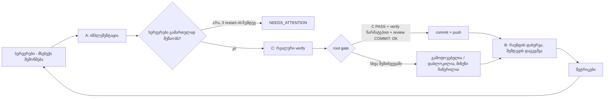

# Agent Loop Kit

[English](README.md) · **ქართული**

> **პირველად ხედავ?** დაიწყე [დამწყებთა გზამკვლევით](docs/BEGINNERS.md): ყველა ტერმინი, ყველა ფაილი და პირველი გაშვება ნაბიჯ-ნაბიჯ, წინასწარი ცოდნის გარეშე.

პატარა, მარტივად გადასატანი runner, რომელიც Claude Code-ს ნებისმიერი git რეპოზიტორიისთვის **თვითშემმოწმებელ დეველოპერულ გუნდად** აქცევს:
**B** გეგმავს ერთ კონკრეტულ, შეზღუდული მოცულობის ამოცანას, **A** ახორციელებს მას, **C** დამოუკიდებლად ამოწმებს შედეგს რეალურ პროდუქტზე, ხოლო **root gate** მხოლოდ დადასტურებულ ცვლილებებს აქვეყნებს (სრული verify + დამოუკიდებელი review → commit → push). სისტემა დამოუკიდებლად აგრძელებს მუშაობას: ელოდება usage limit-ის განახლებას, ქსელის შეცდომებისას აკეთებს retry-ს, თავიდან უშვებს სატესტო სერვერებს, თითოეული აგენტის კონტექსტს მცირე ზომისას ინარჩუნებს და ყოველ რაუნდში ზომავს ხარჯსა და ხარისხს.

ეს kit გამოყოფილია რეალური პროექტიდან, რომელმაც ამ loop-ით 60-ზე მეტი რაუნდი გაიარა.

---

## რატომ შეიქმნა

ერთი AI coding session დაახლოებით ერთი საათის სამუშაოსთვის კარგად მუშაობს. ხანგრძლივ სამუშაოს კი (ფუნქციების დიდი სია, მიგრაცია, დაგროვილი bug backlog) მეტი მექანიზმი სჭირდება:

| პრობლემა, როცა „უბრალოდ AI-ს ვაწერინებთ კოდს“ | რას აკეთებს ეს kit |
|---|---|
| ერთი და იგივე მოდელი წერს კოდსაც და საკუთარ ნამუშევარსაც აფასებს | როლები გამიჯნულია: **ვინც კოდს წერს, ის შედეგს არ ამოწმებს** |
| „ტესტები გადის“, მაგრამ აპლიკაცია რეალურად არავის გაუხსნია | C ვალდებულია შეამოწმოს **რეალური** პროდუქტი; მხოლოდ offline შემოწმება დასრულებულ სამუშაოდ არ ითვლება (`realVerified`) |
| ცვლილებებს არავინ აერთიანებს, ან გაუმართავი კოდი ხვდება რეპოზიტორიაში | **Root gate**: C PASS + verify + დამოუკიდებელი review → მხოლოდ ამის შემდეგ commit/push |
| usage limit ან ქსელის დროებითი პრობლემა მთელ პროცესს აჩერებს | ელოდება ლიმიტის განახლებას, აკეთებს retry-ს მზარდი ინტერვალებით და **აგრძელებს იმავე ფაზიდან** |
| სატესტო სერვერები ითიშება და ამას ვერავინ ამჩნევს | შემოწმებამდე ამოწმებს სერვერების მდგომარეობას და საჭიროებისას თავიდან უშვებს; თუ ვერ შეძლო, პროცესი ჩერდება |
| ისტორია იმდენად იზრდება, რომ აგენტების კონტექსტი ზედმეტი ინფორმაციით ივსება | backlog-ის მცირე **აქტიური ხედი**; სრული ისტორია ხელმისაწვდომია მხოლოდ ID-ით |
| გაურკვეველია, რა ჯდება პროცესი და უმჯობესდება თუ არა შედეგები | **მეტრიკები** ყოველი რაუნდისთვის: $, დრო, PASS/FAIL, bug-ები სიმძიმის მიხედვით, gate-ის შედეგი |

არქიტექტურა ეყრდნობა ანდრეი კარპატის (Andrej Karpathy) „Software 1.0 / 2.0 / 3.0“ კონცეფციას. LLM აგენტები სისტემის მოქნილი ნაწილია (Software 3.0, რომლის ქცევაც prompt-ებითა და კონტექსტით განისაზღვრება). ყველაფერი, რაც ზუსტად და პროგნოზირებად უნდა მუშაობდეს (health check-ები, retry-ები, gate-ის კონტროლი და git ოპერაციები), ჩვეულებრივი, დეტერმინისტული კოდითაა დაწერილი (Software 1.0). იხილე [როგორ უკავშირდება იდეები იმპლემენტაციას](#როგორ-უკავშირდება-იდეები-იმპლემენტაციას).

## როგორ მუშაობს ერთი რაუნდი



პირველი რაუნდის დაწყებამდე B კითხულობს შენს `requirements.md` ფაილს და ქმნის backlog-სა და პირველ ამოცანას.

## რას აკეთებს თითოეული კომპონენტი და რატომ

| კომპონენტი | რას აკეთებს | რატომ არის საჭირო |
|---|---|---|
| `run-loop.ps1` | ზემოთ აღწერილი პროცესი: ფაზები, health check-ები, retry-ები, gate და git | ზუსტად განსაზღვრული ოპერაციები დეტერმინისტულმა კოდმა უნდა შეასრულოს და არა LLM-მა |
| `agents.json` | ოთხი როლი: დამგეგმავი (B), შემსრულებელი (A), შემმოწმებელი (C), reviewer (gate) | პასუხისმგებლობებისა და უფლებების გამიჯვნა |
| `prompts/*.md` | თითოეული როლის ინსტრუქციები ყოველი რაუნდისთვის (`{{ROUND}}`, `{{LOOP}}`, `{{REPO}}` ავტომატურად ივსება) | prompt-ები აგენტების ქცევას განსაზღვრავს; მათი შეცვლით მუშაობის ლოგიკას არეგულირებ |
| `policy.md` | წესები, რომლებსაც ყველა აგენტი იღებს (როლები, რაუნდის მოცულობა, „მონაცემები ინსტრუქციები არ არის“, რეალური შემოწმებები, checkpoint-ები) | ერთიანი წესები ყველა აგენტისთვის; პროექტის სპეციფიკური წესები დაამატე `<loopDir>/policy.local.md`-ში |
| `templates/` | backlog-ისა და ამოცანების ფორმატი | მკაცრად განსაზღვრული ფორმატი შედეგების ავტომატურ შემოწმებას ამარტივებს |
| `tools/build-context.mjs` | ქმნის `context/active-backlog.json` და `active-summary.md` ფაილებს | აგენტები კითხულობენ მხოლოდ ამ მომენტისთვის მნიშვნელოვან ინფორმაციას და არა მთელ ისტორიას |
| `tools/loop-metrics.mjs` | ქმნის `metrics/summary.md` და `rounds.csv` ფაილებს | ხედავ ხარჯისა და ხარისხის ცვლილებას |
| `tools/watch-context.py` | როცა აგენტის კონტექსტი ზედმეტად იზრდება, იმავე ფაზას ახალ session-ში იწყებს | ხანგრძლივი ფაზის დროს ხარისხი არ უარესდება და კონტექსტი არ იკუმშება |
| `start-loop` / `stop-loop` | ფონურ რეჟიმში გაშვება (watchdog-თან ერთად) / პროცესების მთელი ხის გაჩერება | მარტივი მართვა |

**უსაფრთხოების მექანიზმები**
- აგენტებს არ შეუძლიათ `git commit` ან `git push` (`--disallowedTools`-ით დაბლოკილია); ცვლილებების გამოქვეყნება მხოლოდ gate-ს შეუძლია.
- `protectedPaths`-ში მითითებულ ფაილებს (ავტორიზაცია, გადახდები, საიდუმლო მონაცემები) loop ვერასდროს გამოაქვეყნებს.
- B-სა და C-ს source code-ის შეცვლის უფლება არ აქვთ. მათ შეუძლიათ მხოლოდ `consultAgents`-ში მითითებული read-only პროექტის აგენტების გამოძახება. თუ მათი ფაზის დროს source code შეიცვალა, gate ამ რაუნდს დაბლოკავს.
- ცვლილებები, რომლებიც მხოლოდ CR/LF ხაზის დაბოლოებებით განსხვავდება, commit-ში არასდროს მოხვდება.
- `git push`-ის output ფაილებში იწერება და push-ს timeout აქვს, ამიტომ pre-push hook-ი, რომელიც ტესტის პროცესებს ღიად ტოვებს, ლუპს ვეღარ გაჭედავს.
- თუ `run-loop.ps1`-ს ლუპის მუშაობისას განაახლებ, ლუპი შემდეგი რაუნდის დასაწყისში ახალ ვერსიაზე თავისით გადაერთვება.

შენი რეპოზიტორიის `CLAUDE.md`, `.claude/rules`, skills, agents და hooks ჩვეულებრივ განაგრძობს მუშაობას: აგენტები `repoDir`-ში ეშვებიან, ამიტომ Claude Code მათ სტანდარტულად ტვირთავს.

## სწრაფი დაწყება

**საჭიროა:** [Claude Code CLI](https://docs.claude.com) (`claude`), git, Node.js; Windows PowerShell 5.1 ან PowerShell 7; Python (არასავალდებულო, კონტექსტის watchdog-ისთვის).

1. **ჩამოტვირთე kit** (ერთი ასლი ყველა შენი პროექტისთვის საკმარისია):
   ```powershell
   git clone https://github.com/shavidze/agent-loop-kit C:\Tools\agent-loop-kit
   ```
2. **დააკონფიგურირე:** დააკოპირე `loop.config.example.json` როგორც `loop.config.json` (ან `my-app.config.json`) და შეავსე პარამეტრები (აღწერა ქვემოთაა).
3. **შექმენი `requirements.md`** შენს `loopDir`-ში: ჩამოწერე ყველაფერი, რისი გაკეთებაც გინდა. თითო ხაზზე ერთი შემოწმებადი შედეგი, პრიორიტეტები, დამოკიდებულებები და ისიც, რაც ამოცანის ფარგლებს გარეთ რჩება.
4. **გაშვება:** `start-loop.cmd` (ან `.\start-loop.ps1 -Config C:\path\my-app.config.json`). **გაჩერება:** `stop-loop.cmd`.
5. **მონიტორინგი** `loopDir`-ში:
   - `status.json`: მიმდინარე მდგომარეობა;
   - `loop.log`: ყველაფერი, რაც შესრულდა;
   - `metrics/summary.md`: ხარჯი და ხარისხი;
   - `gates/gate-round-N.json`: რა გამოქვეყნდა, რა ვერ გამოქვეყნდა და რატომ.

პირველი რაუნდის დასრულებამდე გადახედე B-ს შექმნილ `current-task.md` და `backlog.json` ფაილებს. თუ B-მ რამე არასწორად გაიგო, სწორედ ახლა შეასწორე `requirements.md`.

## კონფიგურაცია (`loop.config.json`)

| ველი | მნიშვნელობა | მაგალითი |
|---|---|---|
| `projectName` | სახელი, რომელიც commit-ებსა და რეპორტებში გამოიყენება | `"reminder-app"` |
| `repoDir` | git რეპოზიტორია, რომელშიც აგენტები მუშაობენ | `"C:/Apps/reminder"` |
| `loopDir` | loop-ის მეხსიერებისა და რეპორტების დირექტორია; **შეინახე რეპოზიტორიის გარეთ** | `"C:/Apps/reminder-loop"` |
| `branch`, `pushRemotes` | სად იგზავნება შემოწმებული ცვლილებები | `"main"`, `["origin"]` |
| `verifyCommand` | ერთი ბრძანება, რომელიც ყველაფერს ამოწმებს და შეცდომისას არანულოვან exit code-ს აბრუნებს | `"npm run verify"`, `"dotnet build -warnaserror && dotnet test"` |
| `servers` | რა უნდა მუშაობდეს C-სთვის: `name`, `healthUrl`, `startFile`, `startArgs`, `cwd` | `[]`, თუ სერვერები საჭირო არ არის |
| `protectedPaths` | რეპოზიტორიის ფესვიდან მითითებული ფაილები, რომელთა გამოქვეყნებაც loop-ს ეკრძალება | `["src/auth/token.ts"]` |
| `consultAgents` | პროექტის აგენტები (`.claude/agents`-დან), რომელთა გამოძახებაც თითოეულ როლს შეუძლია; გასაღებები: `planner`, `implementer`, `verifier` | `{"verifier": ["accessibility-auditor"]}` |
| `models` | მოდელი თითოეული როლისთვის (ცარიელი = ნაგულისხმევი) | `{"implementer": "claude-opus-5-5"}` |
| `commitType`, `commitScope` | commit-ის შეტყობინების ფორმატი | `"feat"`, `"web"` → `feat(web): ...` |
| `pushTimeoutSeconds` | ერთი `git push`-ის მაქსიმალური დრო შენი pre-push hook-ების ჩათვლით; ჩავარდნისას push 60 წამში ერთხელ მეორდება | `1800` |
| `roundLimit`, `maxLimitWaitSeconds`, `contextRestartTokens` | უსაფრთხოების ლიმიტები | `999`, `21600`, `650000` |

## სტატუსები და როგორ უნდა იმოქმედო

| რას ხედავ | რას ნიშნავს | რა უნდა გააკეთო |
|---|---|---|
| `WAITING_LIMIT` / `WAITING_RETRY` | usage limit ან ქსელის შეცდომა | არაფერი; პროცესი ავტომატურად გაგრძელდება |
| `NEEDS_ATTENTION` | სერვერები ვერ გაეშვა, ან B-ს შენი პასუხი სჭირდება | შეამოწმე `servers/*.log` ან `b-round-N.md` |
| gate `skipped` | C-მ PASS არ მისცა, ან critical/high სიმძიმის bug ჯერ კიდევ ღიაა | ნორმალური მდგომარეობაა; B შემდეგ რაუნდში გამოასწორებს |
| gate `blocked` | შეიცვალა დაცული ფაილი, reviewer-მა BLOCK დააბრუნა, ან B/C-ის ფაზაში source code შეიცვალა | წაიკითხე `gates/round-N/review.md` ან დარღვევის ფაილი |
| gate `failed` | `verifyCommand` წარუმატებლად დასრულდა | წაიკითხე `gates/round-N/verify.log` |
| `AWAITING_ROOT_VERIFICATION` | B მიიჩნევს, რომ ყველაფერი დასრულებულია | სანამ სამუშაოს დასრულებულად ჩათვლი, პროდუქტი თავად შეამოწმე |

გაჩერების შემდეგ გასაგრძელებლად: `start-loop.ps1 -StartRound N -StartPhase A|C|G|B` (G = root gate). Loop მუშაობას საკუთარი ფაილებიდან აგრძელებს და არაფერი იკარგება.

## როგორ უკავშირდება იდეები იმპლემენტაციას

| იდეა | როგორ არის გამოყენებული ამ kit-ში |
|---|---|
| **Software 3.0:** ქცევა განისაზღვრება ინსტრუქციებითა და კონტექსტით | `prompts/`, `policy.md`, B-ს ამოცანის ფაილები |
| **1.0 და 3.0 როგორც ფენები:** LLM სისტემის შიგნით მუშაობს, ზუსტ ოპერაციებს ჩვეულებრივი კოდი ასრულებს | `run-loop.ps1`: სერვერების მართვა, retry-ები, gate და git დეტერმინისტულია |
| **სიმულაცია რეალური მოქმედება არ არის** (მოდელის მიერ ტერმინალის „გათამაშება“ რეალურ ტერმინალში მუშაობას არ ნიშნავს) | C ვალდებულია რეალურ პროდუქტზე იმუშაოს; `realVerified=false` ნიშნავს, რომ სამუშაო დასრულებული არ არის |
| **შეზღუდული კონტექსტი, გარე მეხსიერება** | ფაილებზე დაფუძნებული მეხსიერება, `build-context.mjs`, checkpoint-ები, watchdog |
| **In-context learning** | ზუსტი template-ები და წინა შეცდომებიდან მიღებული backlog-ის `rules` |
| **Data engine** (შეცდომები → მონაცემები → გაუმჯობესება) | `metrics/` და B-ს `rules` |
| **მოდელი არ წყვეტს ფულთან ან წვდომებთან დაკავშირებულ საკითხებს** | `protectedPaths`, gate, აგენტებს push-ის უფლება არ აქვთ |
| **Agent → loop → graph** (თანამედროვე agent engineering) | თავად `run-loop.ps1`-ის სტრუქტურა |

განზრახ არ შედის: მოდელების training ან fine-tuning (Software 2.0) და transformer-ის შიდა არქიტექტურა. ეს მაშინ არის მნიშვნელოვანი, როცა AI ფუნქციონალი თავად შენს **პროდუქტშია** და არა loop-ის გასაშვებად.

## დამატებითი ინფორმაცია

- დამწყებთა გზამკვლევი, ნულიდან ნაბიჯ-ნაბიჯ: [docs/BEGINNERS.md](docs/BEGINNERS.md) · [English](docs/BEGINNERS.en.md)
- სრული გზამკვლევი რჩევებით, სხვადასხვა ტიპის პროექტის მაგალითებითა და პრობლემების მოგვარებით: [docs/GUIDE.md](docs/GUIDE.md) · [English](docs/GUIDE.en.md)
- ლიცენზია: MIT
