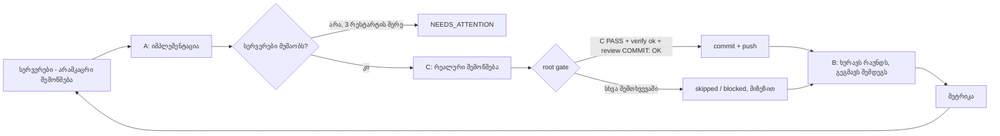

# Agent Loop Kit

[English](README.md) · **ქართული**

პატარა, გადასატანი ინსტრუმენტი, რომელიც Claude Code-ს ნებისმიერ git პროექტზე **თვითშემოწმებად დეველოპერულ გუნდად** აქცევს:
**B** გეგმავს ერთ მკაფიოდ შემოსაზღვრულ დავალებას, **A** მას ასრულებს, **C** დამოუკიდებლად ამოწმებს რეალურ პროდუქტზე, **root gate** კი მხოლოდ შემოწმებულ ნამუშევარს აქვეყნებს: სრული verify → დამოუკიდებელი review → commit → push. ლუპი თავისით მუშაობს. Claude-ის ლიმიტის ამოწურვისას ელოდება, ქსელის შეცდომაზე ცდას იმეორებს, გათიშულ სატესტო სერვერებს თავიდან რთავს, აგენტებს მცირე კონტექსტს აძლევს და ყოველ რაუნდში ზომავს ხარჯსა და ხარისხს.

კიტი რეალური პროექტიდან გამოვიდა, სადაც ამ ლუპით 60-ზე მეტი რაუნდი გაიარა.

---

## რისთვის არის

AI-სთან ერთი სესია ერთი საათის სამუშაოსთვის კარგად მუშაობს. გრძელ სამუშაოს (ფუნქციების სია, მიგრაცია, ბაგების დიდი სია) მეტი სჭირდება:

| პრობლემა, როცა AI-ს უბრალოდ კოდს აწერინებ | რას აკეთებს კიტი |
|---|---|
| ერთი და იგივე მოდელი წერს და თავადვე აფასებს თავის ნამუშევარს | ცალკე როლები: **ვინც წერს, ის არ ამოწმებს** |
| „ტესტები გავიდა“, აპლიკაცია კი არავის გაუხსნია | C ვალდებულია **რეალური** პროდუქტი შეამოწმოს. ოფლაინ PASS არასდროს ითვლება „მზად“-ად (`realVerified`) |
| merge-ს არავინ აკეთებს, ან გაფუჭებული კოდი მიდის | **root gate**: C PASS + verify + დამოუკიდებელი review, და მხოლოდ ამის შემდეგ commit/push |
| ლიმიტი ან ქსელის ხარვეზი ყველაფერს აჩერებს | ლიმიტის reset-ს ელოდება, შეცდომაზე backoff-ით იმეორებს და **იმავე ფაზას აგრძელებს** |
| სატესტო სერვერი ითიშება და ამას ვერავინ ამჩნევს | შემოწმებამდე ამოწმებს სერვერებს და საჭიროებისას რთავს. თუ ვერ ჩართო, ჩერდება |
| ისტორია იზრდება და აგენტები კონტექსტში იხრჩობიან | backlog-ის მცირე **აქტიური ხედი**. სრული ისტორია მხოლოდ ID-ით იძებნება |
| არ იცი, რა ღირს და უმჯობესდება თუ არა | **მეტრიკა** ყოველ რაუნდზე: $, დრო, PASS/FAIL, ბაგები severity-ით, gate-ის შედეგი |

დიზაინი ანდრეი კარპათის „Software 1.0 / 2.0 / 3.0“ ხედვას მიჰყვება. LLM-აგენტები სისტემის მოქნილი ნაწილია (Software 3.0, რომელსაც prompt-ითა და კონტექსტით ვაპროგრამებთ). ყველაფერი, რაც ზუსტად უნდა შესრულდეს (სერვერების შემოწმება, retry, gate, git), ჩვეულებრივი დეტერმინისტული კოდია (Software 1.0). იხ. [როგორ აისახება იდეები](#როგორ-აისახება-იდეები).

## როგორ მუშაობს ერთი რაუნდი



პირველ რაუნდამდე B კითხულობს შენს `requirements.md`-ს და ქმნის backlog-სა და პირველ დავალებას.

## რა რას აკეთებს და რატომ

| ნაწილი | რას აკეთებს | რატომ |
|---|---|---|
| `run-loop.ps1` | ზემოთ მოცემული graph: ფაზები, სერვერები, retry, gate, git | ზუსტი სამუშაო დეტერმინისტულ კოდს ეკუთვნის და არა LLM-ს |
| `agents.json` | ოთხი როლი: planner (B), implementer (A), verifier (C), reviewer (gate) | პასუხისმგებლობა და უფლებები ერთმანეთისგან გამიჯნულია |
| `prompts/*.md` | თითოეული როლის დავალება რაუნდისთვის (`{{ROUND}}`, `{{LOOP}}`, `{{REPO}}` ავტომატურად ივსება) | prompt-ი აგენტების პროგრამაა. ქცევის შესაცვლელად ის შეცვალე |
| `policy.md` | წესები, რომლებიც ყველა აგენტს ეგზავნება: როლები, რაუნდის ზომა, „მონაცემი ინსტრუქცია არ არის“, რეალური შემოწმება, checkpoint-ები | ერთი საერთო კონტრაქტი. პროექტის საკუთარი წესები ჩაწერე `<loopDir>/policy.local.md`-ში |
| `templates/` | backlog-ისა და დავალების ფორმატი | მკაცრი ფორმატის გამო შედეგი შემოწმებადია |
| `tools/build-context.mjs` | წერს `context/active-backlog.json`-სა და `active-summary.md`-ს | აგენტები კითხულობენ იმას, რაც ახლა მნიშვნელოვანია, და არა მთელ ისტორიას |
| `tools/loop-metrics.mjs` | წერს `metrics/summary.md`-სა და `rounds.csv`-ს | ჩანს ხარჯისა და ხარისხის დინამიკა |
| `tools/watch-context.py` | როცა აგენტის კონტექსტი ზედმეტად იზრდება, იმავე ფაზას ახალ სესიაში რესტარტავს | გრძელი ფაზა არ უარესდება და არ იკუმშება |
| `start-loop` / `stop-loop` | ფონზე გაშვება (watchdog-იანად) / პროცესების მთელი ხის გაჩერება | მარტივი მართვა |

**დაცვის მექანიზმები**
- აგენტებს `git commit` და `git push` აკრძალული აქვთ (`--disallowedTools`). აქვეყნებს მხოლოდ gate.
- `protectedPaths` (auth, გადახდები, საიდუმლოებები) ლუპის commit-ში არასდროს მოხვდება.
- B და C source კოდს ვერ ცვლიან. მათ შეუძლიათ მხოლოდ იმ read-only აგენტების გამოძახება, რომლებიც `consultAgents`-ში ჩამოთვალე. თუ მათი ფაზის დროს source შეიცვალა, gate იმ რაუნდს არ აქვეყნებს.
- ცვლილება, რომელიც მხოლოდ CR/LF line ending-ით განსხვავდება, commit-ში არასდროს შედის.

შენი რეპოს `CLAUDE.md`, `.claude/rules`, skill-ები, აგენტები და hook-ები ჩვეულებრივ მუშაობს: აგენტები `repoDir`-ში ეშვებიან და Claude Code მათ ისე ტვირთავს, როგორც ყოველთვის.

## სწრაფი დაწყება

**საჭიროა:** [Claude Code CLI](https://docs.claude.com) (`claude`), git, Node.js; Windows PowerShell 5.1 ან PowerShell 7; Python (არასავალდებულოა, კონტექსტის watchdog-ისთვის).

1. **ჩამოტვირთე კიტი** (ერთი ასლი ყველა პროექტს ჰყოფნის):
   ```powershell
   git clone https://github.com/shavidze/agent-loop-kit C:\Tools\agent-loop-kit
   ```
2. **დააკონფიგურირე:** დააკოპირე `loop.config.example.json` როგორც `loop.config.json` (ან `my-app.config.json`) და შეავსე (ცხრილი ქვემოთაა).
3. **დაწერე `requirements.md`** შენს `loopDir`-ში: სრული სია, რა გინდა. თითო ხაზზე ერთი შემოწმებადი შედეგი, პრიორიტეტები, დამოკიდებულებები და რა არ შედის.
4. **გაუშვი:** `start-loop.cmd` (ან `.\start-loop.ps1 -Config C:\path\my-app.config.json`). **გაჩერება:** `stop-loop.cmd`.
5. **თვალი ადევნე** `loopDir`-ში:
   - `status.json`: სად არის;
   - `loop.log`: ყველაფერი, რაც გააკეთა;
   - `metrics/summary.md`: ხარჯი და ხარისხი;
   - `gates/gate-round-N.json`: რა გამოქვეყნდა და რატომ, ან რატომ არა.

პირველი რაუნდის დასრულებამდე წაიკითხე B-ს პირველი `current-task.md` და `backlog.json`. თუ B-მ რამე არასწორად გაიგო, `requirements.md` ახლავე გაასწორე.

## კონფიგურაცია (`loop.config.json`)

| ველი | რას ნიშნავს | მაგალითი |
|---|---|---|
| `projectName` | სახელი commit-ებსა და ანგარიშებში | `"reminder-app"` |
| `repoDir` | git რეპო, სადაც აგენტები მუშაობენ | `"C:/Apps/reminder"` |
| `loopDir` | ლუპის მეხსიერება და ანგარიშები. **რეპოს გარეთ ამყოფე** | `"C:/Apps/reminder-loop"` |
| `branch`, `pushRemotes` | სად იფუშება შემოწმებული ნამუშევარი | `"main"`, `["origin"]` |
| `verifyCommand` | ერთი ბრძანება, რომელიც ყველაფერს ამოწმებს და შეცდომაზე არანულოვან კოდს აბრუნებს | `"npm run verify"`, `"dotnet build -warnaserror && dotnet test"` |
| `servers` | რა უნდა მუშაობდეს C-სთვის: `name`, `healthUrl`, `startFile`, `startArgs`, `cwd` | `[]`, თუ არაფერი |
| `protectedPaths` | რეპოს ფაილები, რომლებსაც ლუპი ვერასდროს გამოაქვეყნებს | `["src/auth/token.ts"]` |
| `consultAgents` | პროექტის აგენტები (`.claude/agents`-იდან), რომლებსაც თითოეული როლი იძახებს: გასაღებები `planner`, `implementer`, `verifier` | `{"verifier": ["accessibility-auditor"]}` |
| `models` | მოდელი როლის მიხედვით (ცარიელი = default) | `{"implementer": "claude-opus-5-5"}` |
| `commitType`, `commitScope` | commit-ის შეტყობინების ფორმატი | `"feat"`, `"web"` → `feat(web): ...` |
| `roundLimit`, `maxLimitWaitSeconds`, `contextRestartTokens` | უსაფრთხოების ზღვრები | `999`, `21600`, `650000` |

## სტატუსები და რა ვქნა

| რას ხედავ | რას ნიშნავს | რა ქნა |
|---|---|---|
| `WAITING_LIMIT` / `WAITING_RETRY` | ლიმიტი ან ქსელის შეცდომა | არაფერი, თავისით გააგრძელებს |
| `NEEDS_ATTENTION` | სერვერები ვერ ჩაირთო, ან B-ს შენი პასუხი სჭირდება | ნახე `servers/*.log` ან `b-round-N.md` |
| gate `skipped` | C-მ PASS არ მისცა, ან critical/high ბაგი ღიაა | ნორმალურია, B შემდეგ რაუნდში ასწორებს |
| gate `blocked` | protected ფაილი შეიცვალა, reviewer-მა BLOCK თქვა, ან C/B-ს დროს source შეიცვალა | წაიკითხე `gates/round-N/review.md` ან violation ფაილი |
| gate `failed` | `verifyCommand` ჩავარდა | წაიკითხე `gates/round-N/verify.log` |
| `AWAITING_ROOT_VERIFICATION` | B-ს აზრით ყველაფერი მზადაა | დასრულებულად ჩათვლამდე პროდუქტი თავად შეამოწმე |

გაჩერების შემდეგ გაგრძელება: `start-loop.ps1 -StartRound N -StartPhase A|C|G|B` (G = root gate). ლუპი თავისი ფაილებიდან აგრძელებს და არაფერს კარგავს.

## როგორ აისახება იდეები

| იდეა | კიტში |
|---|---|
| **Software 3.0:** ქცევა ინსტრუქციებითა და კონტექსტით პროგრამირდება | `prompts/`, `policy.md`, B-ს დავალებები |
| **1.0 და 3.0 ფენებად:** LLM სისტემის შიგნითაა, ზუსტ საქმეს კი ჩვეულებრივი კოდი აკეთებს | `run-loop.ps1`: სერვერები, retry, gate და git დეტერმინისტულია |
| **სიმულაცია ≠ მოქმედება** (მოდელი, რომელიც terminal-ს „თამაშობს“, terminal არ არის) | C რეალურ პროდუქტს იყენებს. `realVerified=false` ნიშნავს, რომ „მზად არ არის“ |
| **შეზღუდული კონტექსტი, გარე მეხსიერება** | ფაილებზე დაფუძნებული მეხსიერება, `build-context.mjs`, checkpoint-ები, watchdog |
| **In-context learning** | ზუსტი შაბლონები და backlog-ის `rules`, წარსული შეცდომებიდან ნასწავლი |
| **Data engine** (შეცდომები → მონაცემი → გაუმჯობესება) | `metrics/` და B-ს `rules` |
| **მოდელი ფულსა და წვდომას არ წყვეტს** | `protectedPaths`, gate, აგენტებს push არ შეუძლიათ |
| **Agent → loop → graph** (თანამედროვე agent engineering) | თავად `run-loop.ps1`-ის სტრუქტურა |

განზრახ არ შედის: მოდელების გაწვრთნა ან fine-tuning (Software 2.0) და Transformer-ის შიდა მექანიზმები. ეს მაშინ გჭირდება, როცა **პროდუქტში** აკეთებ AI ფუნქციას და არა ლუპის გასაშვებად.

## მეტი

- სრული გზამკვლევი რჩევებით, პროექტის ტიპების მიხედვით მაგალითებითა და პრობლემების გადაჭრით: [docs/GUIDE.md](docs/GUIDE.md) · [English](docs/GUIDE.en.md)
- ლიცენზია: MIT
