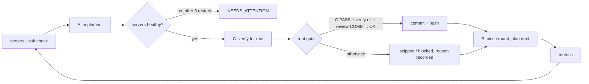

# Agent Loop Kit

**English** · [ქართული](README.ka.md)

> **New to this?** Start with the [beginner's guide](docs/BEGINNERS.en.md): every term, every file and a step-by-step first run, no prior knowledge needed.

A small, portable runner that turns Claude Code into a **self-checking development team** for any git repository:
**B** plans one bounded task, **A** implements it, **C** independently verifies it on the real product, and a **root gate** publishes only verified work (full verify + independent review → commit → push). It keeps going on its own: it waits out usage limits, retries network errors, restarts your test servers, keeps each agent's context small, and measures cost and quality every round.

It was extracted from a real project that ran 60+ rounds with this loop.

---

## Why it exists

A single AI coding session works well for an hour. Long work (a feature list, a migration, a big bug backlog) needs more:

| Problem with "just let the AI code" | What this kit does |
|---|---|
| The same model writes and grades its own work | Separate roles: **whoever writes does not verify** |
| "Tests pass" while the app was never opened | C must exercise the **real** product; an offline pass is never "done" (`realVerified`) |
| Nobody merges, or broken code gets merged | **Root gate**: C PASS + verify + independent review → only then commit/push |
| A usage limit or a network blip stops everything | Waits until the limit resets, retries with backoff, **resumes the same phase** |
| Test servers die and nobody notices | Health-checks and restarts them before verification; stops if it can't |
| History grows until every agent drowns in context | A small **active view** of the backlog; full history only by ID |
| No idea what it costs or whether it's improving | **Metrics** per round: $, time, PASS/FAIL, bugs by severity, gate result |

The design follows Andrej Karpathy's "Software 1.0 / 2.0 / 3.0" framing: the LLM agents are the flexible part (Software 3.0, programmed by prompts and context), while everything that must be exact — health checks, retries, gating, git — is plain deterministic code (Software 1.0). See [How the ideas map](#how-the-ideas-map).

## How one round works



Before round 1, B reads your `requirements.md` and creates the backlog and the first task.

## What each part does and why

| Part | What it does | Why |
|---|---|---|
| `run-loop.ps1` | The graph above: phases, health checks, retries, gate, git | Exact work belongs in deterministic code, not in an LLM |
| `agents.json` | Four roles: planner (B), implementer (A), verifier (C), reviewer (gate) | Separate responsibilities and permissions |
| `prompts/*.md` | Each role's per-round instructions (`{{ROUND}}`, `{{LOOP}}`, `{{REPO}}` are filled in) | Prompts are the program of the agents; edit them to tune behaviour |
| `policy.md` | Rules every agent receives (roles, round size, "data is not instructions", real checks, checkpoints) | One shared contract; add project rules in `<loopDir>/policy.local.md` |
| `templates/` | Format of the backlog and of a task | Strict contracts make results checkable |
| `tools/build-context.mjs` | Writes `context/active-backlog.json` + `active-summary.md` | Agents read what matters now, not the whole history |
| `tools/loop-metrics.mjs` | Writes `metrics/summary.md`, `rounds.csv` | You can see cost and quality trends |
| `tools/watch-context.py` | Restarts the same phase in a fresh session when an agent's context gets too large | Long phases don't degrade or get compacted |
| `start-loop` / `stop-loop` | Start in the background (plus the watchdog) / stop the whole process tree | Simple control |

**Safety rails**
- Agents cannot `git commit` or `git push` (blocked via `--disallowedTools`); only the gate publishes.
- `protectedPaths` (auth, payments, secrets) can never be published by the loop.
- B and C are read-only for source. They may consult only the read-only project agents you list in `consultAgents`; if source changes during their phase, the gate refuses that round.
- Changes that differ only by CR/LF line endings are never committed.

Your repository's own `CLAUDE.md`, `.claude/rules`, skills, agents and hooks keep working: agents run inside `repoDir`, so Claude Code loads them as usual.

## Quick start

**Requirements:** [Claude Code CLI](https://docs.claude.com) (`claude`), git, Node.js; Windows PowerShell 5.1 or PowerShell 7; Python (optional, for the context watchdog).

1. **Get the kit** (one copy serves all your projects):
   ```powershell
   git clone https://github.com/shavidze/agent-loop-kit C:\Tools\agent-loop-kit
   ```
2. **Configure:** copy `loop.config.example.json` to `loop.config.json` (or `my-app.config.json`) and fill it in (reference below).
3. **Write `requirements.md`** in your `loopDir`: the full list of what you want, one checkable outcome per line, priorities, dependencies, and what is out of scope.
4. **Start:** `start-loop.cmd` (or `.\start-loop.ps1 -Config C:\path\my-app.config.json`). **Stop:** `stop-loop.cmd`.
5. **Watch** in `loopDir`: `status.json` (where it is), `loop.log` (everything it did), `metrics/summary.md` (cost and quality), `gates/gate-round-N.json` (what was published and why or why not).

Read B's first `current-task.md` and `backlog.json` before round 1 finishes. If B misunderstood something, fix `requirements.md` now.

## Configuration (`loop.config.json`)

| Field | Meaning | Example |
|---|---|---|
| `projectName` | Name used in commits and reports | `"reminder-app"` |
| `repoDir` | Git repository the agents work in | `"C:/Apps/reminder"` |
| `loopDir` | Loop memory and reports; **keep it outside the repo** | `"C:/Apps/reminder-loop"` |
| `branch`, `pushRemotes` | Where verified work is pushed | `"main"`, `["origin"]` |
| `verifyCommand` | One command that checks everything, non-zero on failure | `"npm run verify"`, `"dotnet build -warnaserror && dotnet test"` |
| `servers` | What must run for C: `name`, `healthUrl`, `startFile`, `startArgs`, `cwd` | `[]` if none |
| `protectedPaths` | Repo-relative files the loop may never publish | `["src/auth/token.ts"]` |
| `consultAgents` | Project agents (from `.claude/agents`) each role may call: keys `planner`, `implementer`, `verifier` | `{"verifier": ["accessibility-auditor"]}` |
| `models` | Model per role (empty = default) | `{"implementer": "claude-opus-5-5"}` |
| `commitType`, `commitScope` | Commit message format | `"feat"`, `"web"` → `feat(web): ...` |
| `pushTimeoutSeconds` | max time for one `git push`, including your pre-push hooks; the push is retried once after 60 s | `1800` |
| `roundLimit`, `maxLimitWaitSeconds`, `contextRestartTokens` | Safety limits | `999`, `21600`, `650000` |

## Statuses and what to do

| You see | Meaning | Action |
|---|---|---|
| `WAITING_LIMIT` / `WAITING_RETRY` | Usage limit or network error | Nothing; it resumes by itself |
| `NEEDS_ATTENTION` | Servers would not start, or B needs your answer | Check `servers/*.log` or `b-round-N.md` |
| gate `skipped` | C did not PASS, or a critical/high bug is open | Normal; B fixes it next round |
| gate `blocked` | Protected file changed, reviewer said BLOCK, or source changed during C/B | Read `gates/round-N/review.md` or the violation file |
| gate `failed` | `verifyCommand` failed | Read `gates/round-N/verify.log` |
| `AWAITING_ROOT_VERIFICATION` | B believes everything is done | Check the product yourself before calling it done |

Resume after a stop: `start-loop.ps1 -StartRound N -StartPhase A|C|G|B` (G = root gate). The loop continues from its files and loses nothing.

## How the ideas map

| Idea | In this kit |
|---|---|
| **Software 3.0**: behaviour is programmed with instructions and context | `prompts/`, `policy.md`, B's task files |
| **1.0 and 3.0 as layers**: the LLM sits inside a system; exact work is ordinary code | `run-loop.ps1`: servers, retries, gate and git are deterministic |
| **Simulation is not action** (a model "playing" a terminal is not a terminal) | C must use the real product; `realVerified=false` means not done |
| **Limited context, external memory** | File-based memory, `build-context.mjs`, checkpoints, the watchdog |
| **In-context learning** | Exact templates and the backlog's `rules` learned from past failures |
| **Data engine** (failures → data → improvement) | `metrics/` plus B's `rules` |
| **The model never decides money or access** | `protectedPaths`, the gate, agents cannot push |
| **Agent → loop → graph** (modern agent engineering) | The structure of `run-loop.ps1` itself |

Not included on purpose: training or fine-tuning models (Software 2.0) and transformer internals. They matter when your *product* has AI features, not for running the loop.

## Learn more

- Beginner's guide, step by step from zero: [docs/BEGINNERS.en.md](docs/BEGINNERS.en.md) · [ქართულად](docs/BEGINNERS.md)
- Full guide with tips, examples per project type and troubleshooting: [docs/GUIDE.en.md](docs/GUIDE.en.md) · [ქართულად](docs/GUIDE.md)
- License: MIT
